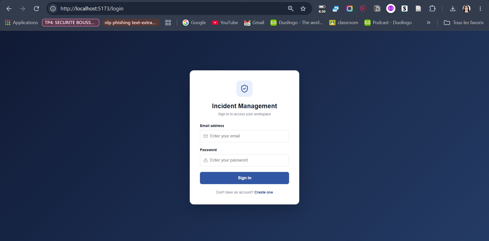
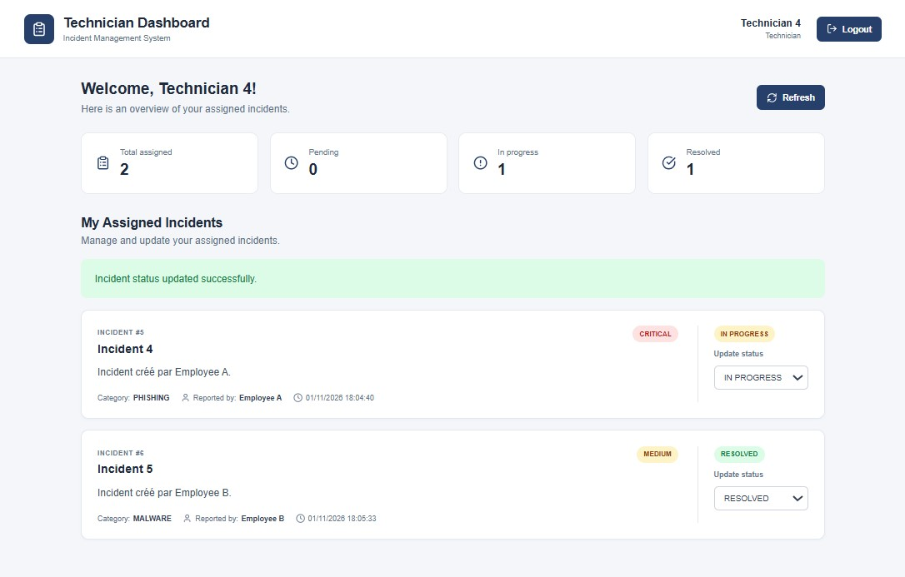
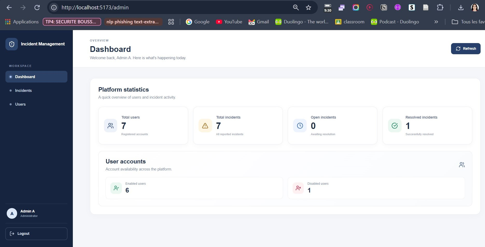
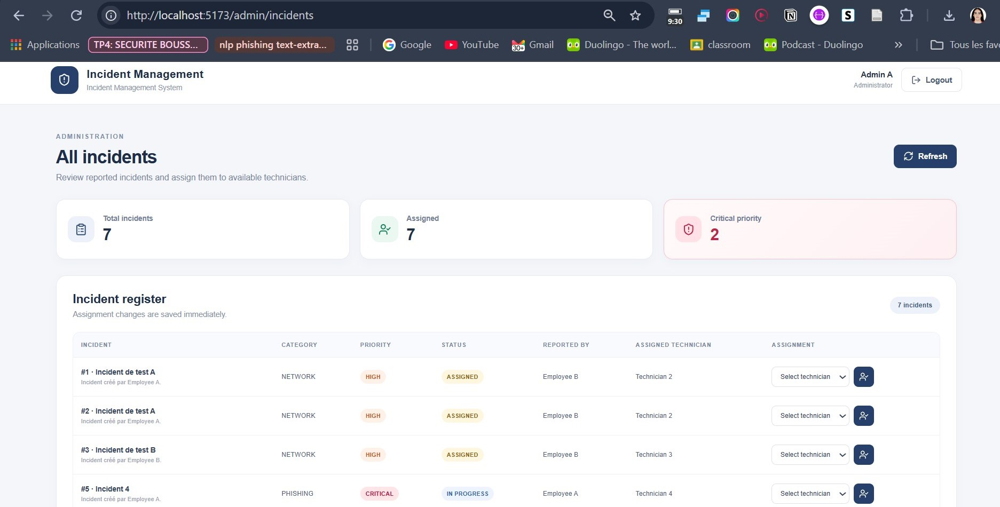
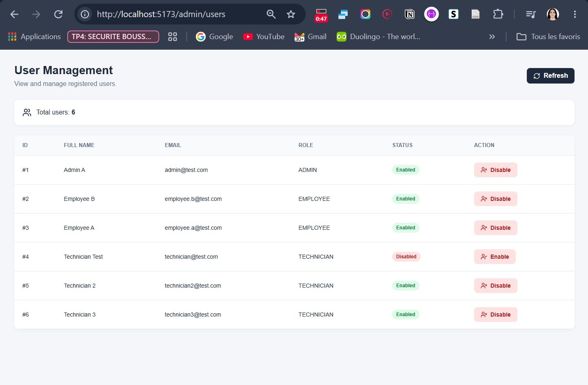

# Incident Management System

A full-stack web application for managing IT and cybersecurity incidents within an organization. The system provides role-based access for employees, technicians, and administrators.

## Overview

The Incident Management System centralizes incident reporting, assignment, tracking, and resolution through a web-based interface.

It follows a role-based architecture to ensure that each user can access only the functionalities authorized for their role.

## Application Preview

IncidentManagement provides dedicated dashboards for each user role, with role-based access and incident management workflows.

### Login



### Employee Dashboard

Employees can report new incidents and track the progress of incidents they have already submitted.

**Reporting an Incident**


**My Incidents**


### Technician Dashboard

Technicians can view assigned incidents and update their progress.



### Administrator Dashboard

Administrators can monitor platform activity and access global statistics.



### Incident Management

Administrators can consult incidents and assign them to technicians.



### User Management

Administrators can manage user accounts and enable or disable access.



## Features

### Authentication and Security
- User registration and login.
- JWT-based authentication.
- Password hashing using BCrypt.
- Role-based authorization.
- Account activation and deactivation.
- Protected API endpoints.

### Employee
- Create incidents.
- View personal incidents.
- Track incident status and assignment.

### Technician
- View assigned incidents.
- Update incident statuses.
- Track assigned work.

### Administrator
- View all incidents.
- Assign incidents to technicians.
- Manage user accounts.
- Enable or disable users.
- View global statistics.

## Technologies

| Layer | Technologies |
|---|---|
| Backend | Java 21, Spring Boot |
| Security | Spring Security, JWT, BCrypt |
| Persistence | Spring Data JPA, Hibernate |
| Database | H2, MySQL Driver |
| Frontend | React, JavaScript, Vite |
| HTTP Client | Axios |
| Routing | React Router |
| Icons | Lucide React |
| Build | Maven, npm |

## Architecture

The application follows a client-server architecture.

```text
                 React Frontend
                 (Port 5173)
                       |
                    Axios
                       |
                       v
              Spring Boot REST API
                 (Port 8081)
                       |
             Spring Security + JWT
                       |
                       v
                Service Layer
                       |
                       v
              Repository Layer
                       |
                       v
                  Database
```

## Project Structure

```text
IncidentManagement/
│
├── backend/
│   └── incident-management/
│       ├── src/
│       │   ├── main/
│       │   │   ├── java/
│       │   │   └── resources/
│       │   └── test/
│       └── pom.xml
│
├── frontend/
│   ├── src/
│   │   ├── api/
│   │   ├── context/
│   │   ├── pages/
│   │   │   ├── admin/
│   │   │   ├── employee/
│   │   │   └── technician/
│   │   └── routes/
│   └── package.json
│
├── docs/
│   ├── diagrams/
│   └── screenshots/
│
└── README.md
```

## Incident Lifecycle

Incidents follow these statuses:

1. **OPEN** – Newly reported incident.
2. **ASSIGNED** – Assigned to a technician.
3. **IN_PROGRESS** – Being investigated.
4. **RESOLVED** – Resolution completed.
5. **CLOSED** – Incident closed.

### Incident Categories

NETWORK, MALWARE, PHISHING, ACCESS, SOFTWARE, HARDWARE, DATA_LEAK, OTHER.

### Priority Levels

LOW, MEDIUM, HIGH, CRITICAL.

## REST API

### Authentication

| Method | Endpoint | Description |
|---|---|---|
| POST | `/auth/register` | Register an employee |
| POST | `/auth/login` | Authenticate a user |

### Incidents

| Method | Endpoint | Description |
|---|---|---|
| POST | `/api/incidents` | Create an incident |
| GET | `/api/incidents/my` | Get personal incidents |
| GET | `/api/incidents/assigned` | Get technician's assigned incidents |
| GET | `/api/incidents/{id}` | Get incident details |
| GET | `/api/incidents` | Get all incidents (Admin) |
| PUT | `/api/incidents/{id}/status` | Update incident status |
| PUT | `/api/incidents/{id}/assign/{technicianId}` | Assign an incident |

### Administration

| Method | Endpoint | Description |
|---|---|---|
| GET | `/api/admin/users` | List users |
| PUT | `/api/admin/users/{id}/enable` | Enable a user |
| PUT | `/api/admin/users/{id}/disable` | Disable a user |
| GET | `/api/admin/statistics` | Retrieve statistics |

### Profile

| Method | Endpoint | Description |
|---|---|---|
| GET | `/api/profile` | Get current profile |
| PUT | `/api/profile` | Update current profile |

## Installation and Execution

### Prerequisites

- Java 21 or later.
- Maven.
- Node.js and npm.
- IntelliJ IDEA or another Java IDE.

### 1. Clone the repository

```bash
git clone https://github.com/houdariyad-etu-gif/IncidentManagement.git
cd IncidentManagement
```

### 2. Start the backend

Configure the required JWT secret as an environment variable:

```text
JWT_SECRET=your_base64_encoded_secret
```

Then run:

```bash
cd backend/incident-management
```

On Windows:

```bash
mvnw.cmd spring-boot:run
```

Or run the main Spring Boot application from your IDE.

The backend runs at:

`http://localhost:8081`

### 3. Start the frontend

Open another terminal:

```bash
cd frontend
npm install
npm run dev
```

The frontend runs at:

`http://localhost:5173`

## Database Configuration

The development configuration uses an H2 in-memory database.

H2 console:

`http://localhost:8081/h2-console`

Database URL:

`jdbc:h2:mem:incidentdb`

**Note:** Data stored in the in-memory database is lost when the backend application stops. MySQL support is included in the project dependencies.

## Documentation

Additional project materials are available in:

- `docs/diagrams/` – Architecture and design diagrams.
- `docs/screenshots/` – Application screenshots.

## Security Considerations

- Passwords are hashed using BCrypt.
- JWT tokens protect authenticated endpoints.
- Registration assigns the EMPLOYEE role by default.
- Administrative operations require ADMIN privileges.
- Employees can access only their own incidents.
- Technicians can manage incidents assigned to them.

Development credentials and secrets should be changed or configured securely before production deployment.

## Author

**Riyad Houda**

Master's Degree in Distributed Systems and Artificial Intelligence (SDIA)

ENSET Mohammedia
